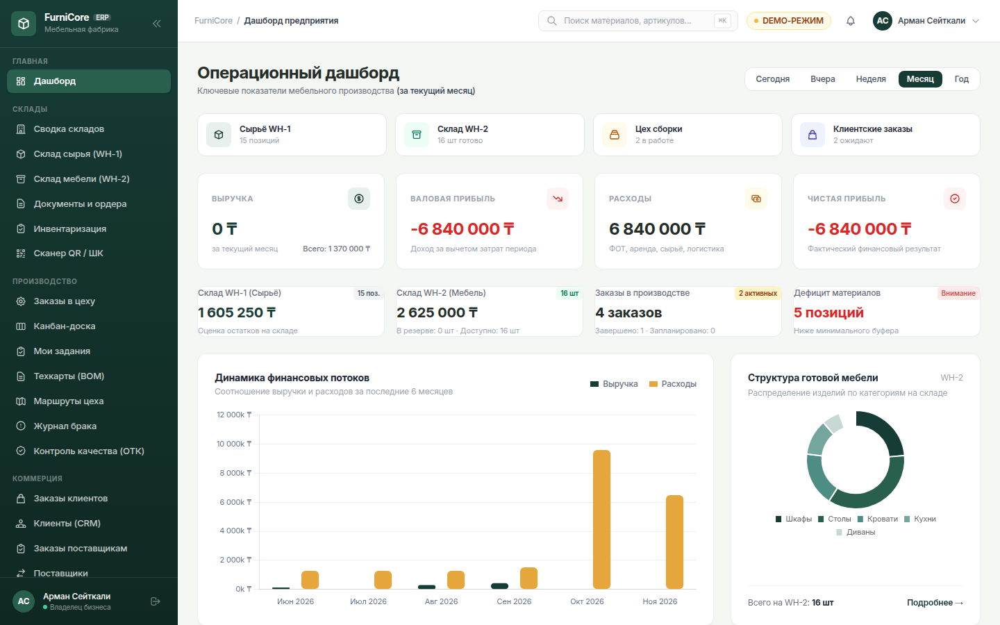
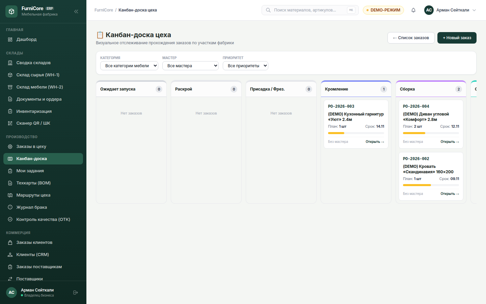
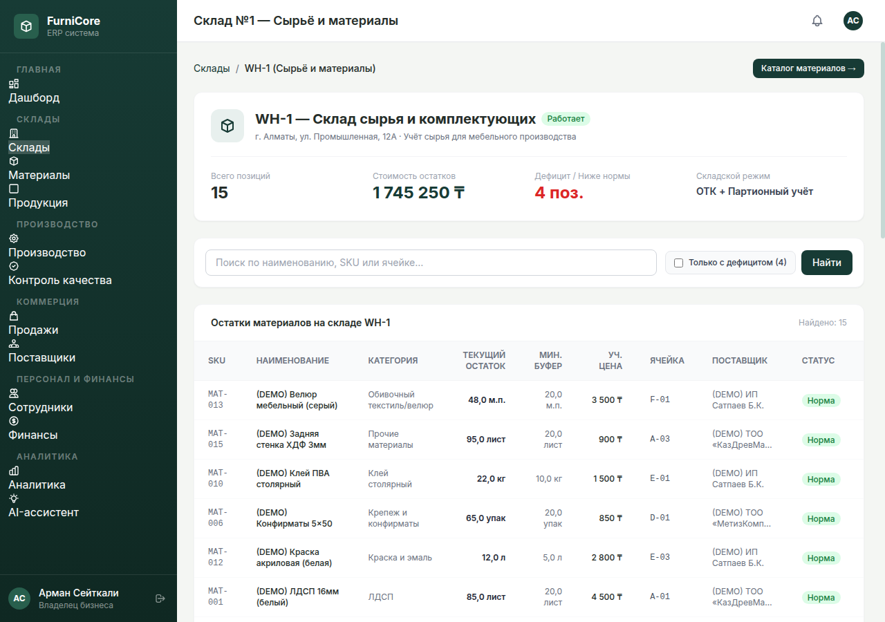
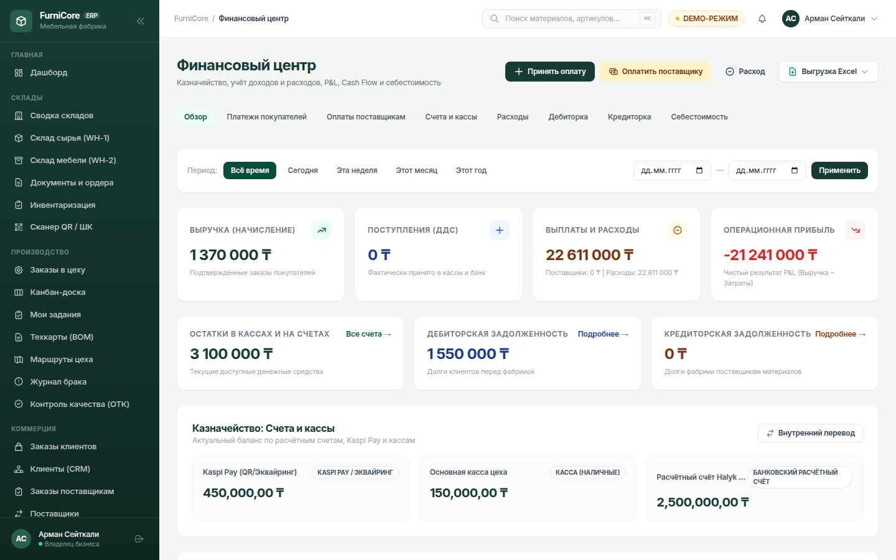
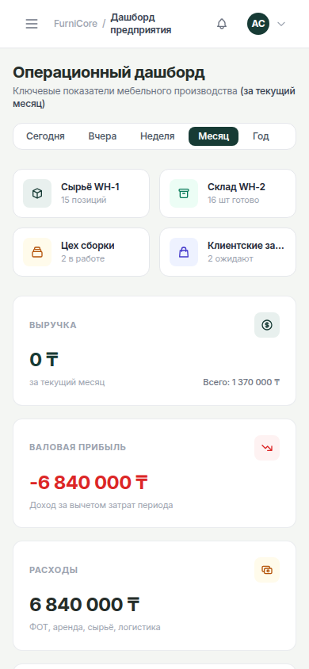
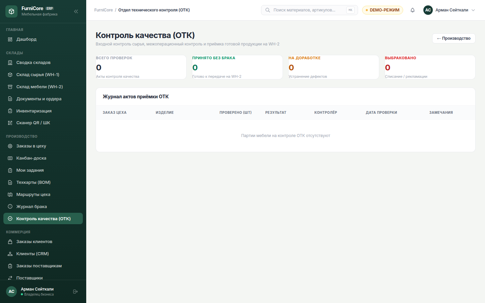

# FurniCore ERP — Модульная ERP-система мебельного производства

[](https://www.python.org/)
[](https://www.djangoproject.com/)
[](https://www.postgresql.org/)
[]()
[]()

**FurniCore ERP** — модульная веб-платформа для автоматизации операционного, производственного, складского и финансового учёта мебельной фабрики полного цикла в Республике Казахстан.

- **Язык интерфейса:** Русский
- **Основная валюта:** Казахстанский тенге (KZT, `₸`)
- **Базовый стек:** Python 3.12, Django 5.1, PostgreSQL 16, Django Templates, Tailwind CSS, Alpine.js, Chart.js, ReportLab, OpenPyXL, Pytest
- **Архивный стек:** Исходный ранний прототип на TypeScript/NestJS/Next.js бережно сохранён в каталоге `furnicore_ts_backup/`

> **ПРЕДУПРЕЖДЕНИЕ ОБ УЧЕБНОМ СТАТУСЕ:**
> Данный проект является **учебным демонстрационным прототипом (MVP)**, разработанным для защиты дипломного/курсового проекта и демонстрации архитектуры ERP-систем. Система **не предназначена для прямой промышленной эксплуатации** без комплексного внешнего аудита безопасности, настройки боевого окружения (Nginx/Gunicorn/PostgreSQL), ротации секретных ключей и интеграции с реальными фискальными регистраторами.

---

## Скриншоты системы

| Главный Дашборд (Desktop) | Канбан-доска цеха |
|:---:|:---:|
|  |  |

| Склад сырья WH-1 (Контроль дефицита) | Финансовый дашборд и казначейство |
|:---:|:---:|
|  |  |

| Мобильная адаптивность (Mobile Dashboard) | Контроль качества (ОТК) |
|:---:|:---:|
|  |  |

---

## 1. Архитектура и функциональные модули

### 1.1. Двухскладская модель учёта (Строго 2 склада)
В системе реализована строгая предметная модель хранения:
1. **WH-1 — Склад сырья и материалов (`/warehouses/wh-1/`):**
   - Учёт плитных материалов (ЛДСП, МДФ, фанера), кромочной ленты, фурнитуры (петли, направляющие, конфирматы), ЛКМ и тканей.
   - Контроль неснижаемого буферного остатка, цветовая индикация дефицита.
2. **WH-2 — Склад готовой продукции (`/warehouses/wh-2/`):**
   - Учёт готовой серийной и индивидуальной мебели.
   - Трёхкомпонентный учёт остатка: **Физический** = **В резерве под клиентов** + **Свободный к отгрузке**.
3. **Производственный цех** трактуется как технологический процесс с переделами и стадиями, а не как склад.
4. **Транзакционный сервисный слой:** Все движения осуществляются через документы (`RECEIPT`, `PRODUCTION_ISSUE`, `PRODUCTION_RETURN`, `FINISHED_RECEIPT`, `SHIPMENT`, `INVENTORY_ADJUSTMENT`, `WRITE_OFF`) с защитой от отрицательных остатков и блокировкой повторного проведения.

### 1.2. Производство и спецификации (BOM)
- **Технологические карты (BOM):** Нормы расхода сырья с процентом технологического отхода, нормы времени мастеров, автоматическая калькуляция плановой себестоимости. Версионирование спецификаций (`v1.0`, `v1.1`...).
- **Производственные заказы:** Жизненный цикл от черновика до сдачи на склад WH-2. Автоматическая инициализация технологических этапов по маршрутам.
- **Канбан-доска цеха (9 стадий):** Раскрой → Обработка/Присадка → Кромление → Сборка → Обивка → Контроль ОТК → Доработка (Rework) → Сдача на склад.
- **Рабочее место мастера (`/production/my-tasks/`):** Персональный список заданий, фиксация затраченных нормо-часов.
- **Семикритериальный контроль качества (ОТК):** Проверка геометрии, прочности, внешнего вида, кромки/ЛКП, комплектности, фурнитуры и отсутствия дефектов. **Инвариант:** оприходование на WH-2 заблокировано до получения вердикта ОТК `PASS`.
- **Журнал брака и отходов:** Регистрация исправимого и неисправимого брака, фиксация ущерба в KZT, учёт потерь в фактической себестоимости.

### 1.3. Снабжение, Продажи и CRM
- **Закупки и поставщики:** Учёт заказов поставщикам, поэтапная приёмка на склад WH-1, контроль сроков оплаты.
- **CRM и продажи мебели:** База клиентов, оформление заказов со скидками, автоматическое резервирование мебели на WH-2, оформление расходных накладных и отгрузка.

### 1.4. Финансы, Казначейство и Себестоимость
- **Казначейство:** Учёт счетов и касс (Касса цеха, расчетные счета Halyk Bank, Kaspi Pay), безопасные межсчетные переводы.
- **Взаиморасчёты:** Регистрация входящих оплат покупателей и исходящих оплат поставщикам с поддержкой частичных платежей, защитой от дублирования и сторнированием.
- **Калькуляция фактической себестоимости:** Сопоставление плановой нормы (BOM) и фактических затрат (сырьё, трудозатраты, брак, накладные расходы).
- **Отчёт P&L (Отчёт о прибылях и убытках):** Расчёт выручки, себестоимости реализованной продукции (COGS), валовой прибыли, операционных расходов и чистой прибыли.
- **Печать и экспорт:** Генерация официальных PDF-квитанций с поддержкой кириллицы и знака тенге (`₸`), экспорт финансовых отчётов в Microsoft Excel (`.xlsx`).

### 1.5. Ролевая модель доступа (RBAC)
- **`OWNER`** — Владелец / Руководитель: полный доступ ко всем разделам и аналитике.
- **`ADMIN`** — Администратор: техническое обслуживание и управление пользователями.
- **`PRODUCTION_MANAGER`** — Начальник производства: управление цехом, спецификациями BOM и выпуском.
- **`WAREHOUSE_MANAGER`** — Заведующий складами: документы WH-1/WH-2, инвентаризация, сканер.
- **`SALES_MANAGER`** — Менеджер продаж: клиенты, оформление заказов и отгрузок.
- **`ACCOUNTANT`** — Главный бухгалтер: казначейство, платежи, расходы, себестоимость и P&L.
- **`WORKER`** — Мастер цеха: персональные сменные задания, отметка этапов.
- **`DEMO_VIEWER`** — Безопасный режим ознакомления для проверяющего/преподавателя: полный доступ на чтение ко всем 13 модулям ERP, аппаратная блокировка любых мутаций данных (HTTP 403 / защитный редирект), доступ в `/admin/` закрыт.

---

## 2. Карта основных маршрутов ERP

| URL | Модуль | Назначение |
|---|---|---|
| `/` | **Dashboard** | Сводные KPI, финансовые показатели, балансы складов, графики Chart.js |
| `/warehouses/` | **Склады** | Обзор двух складов и реестр складских документов |
| `/warehouses/wh-1/` | **Склад WH-1** | Балансы сырья, ячейки хранения, индикаторы дефицита |
| `/warehouses/wh-2/` | **Склад WH-2** | Балансы готовой мебели: физический / резерв / свободный остаток |
| `/warehouses/documents/` | **Документы** | Приход, перемещение, списание, выдача в цех |
| `/warehouses/inventory/` | **Инвентаризация** | Акты инвентаризации и сличительные ведомости |
| `/warehouses/scan/` | **Сканер ШК / QR** | Быстрое сканирование штрихкодов и маркировки изделий |
| `/materials/` | **Материалы** | Каталог сырья, неснижаемые запасы, цены закупки |
| `/products/` | **Продукция** | Каталог мебели, розничные цены, плановая маржинальность |
| `/production/` | **Производство** | Заказы на производство, статус партий, запуск в цех |
| `/production/board/` | **Канбан цеха** | Визуальная доска прохождения 9 производственных стадий |
| `/production/my-tasks/`| **Задания мастеров**| Сменные задания рабочих, фиксация нормо-часов |
| `/production/boms/` | **Спецификации (BOM)**| Техкарты изделий, нормы расхода сырья, калькуляция себестоимости |
| `/production/routes/` | **Маршруты** | Технологические цепочки обработки мебели |
| `/production/waste/` | **Журнал брака** | Фиксация брака, дефектов и технологических отходов |
| `/quality/` | **ОТК** | Журнал семикритериального контроля качества готовой мебели |
| `/sales/` | **Продажи** | Заказы клиентов, статусы оплат и отгрузок мебели |
| `/sales/customers/` | **CRM Клиенты** | База заказчиков, контактные лица, история заказов |
| `/suppliers/` | **Поставщики** | База контрагентов, договоры, закупки сырья |
| `/employees/` | **Сотрудники** | Персонал фабрики, должности, тарифные ставки |
| `/finance/` | **Финансы** | Казначейство, балансы счетов, операционные расходы |
| `/finance/costing/` | **Себестоимость** | План-фактный анализ материальных и трудовых затрат |
| `/finance/export/excel/`| **Экспорт отчётов** | Выгрузка P&L, задолженностей и ДДС в Excel (.xlsx) |
| `/analytics/` | **Аналитика** | Динамика рентабельности, оборачиваемости и загрузки цеха |
| `/ai/` | **AI Ассистент** | Аналитический ассистент руководителя по складским остаткам |

---

## 3. Локальный запуск и установка

### 3.1. Системные требования
- **Python:** 3.12+
- **СУБД:** PostgreSQL 16
- **ОС:** Linux / macOS / Windows (WSL2)

### 3.2. Пошаговая установка

1. **Клонируйте репозиторий:**
   ```bash
   git clone -b python-django https://github.com/isamatovismail-svg/FurniCore_ERP.git
   cd FurniCore_ERP
   ```

2. **Создайте и активируйте виртуальное окружение Python:**
   ```bash
   python3 -m venv .venv
   source .venv/bin/activate
   ```

3. **Установите зависимости:**
   ```bash
   pip install --upgrade pip
   pip install -r requirements.txt
   ```

4. **Настройте переменные окружения:**
   ```bash
   cp .env.example .env
   ```
   *Откройте `.env` и укажите параметры вашей базы данных PostgreSQL (хост, порт, имя базы, пользователь и пароль).*

5. **Примените миграции базы данных:**
   ```bash
   python manage.py migrate
   ```

6. **Инициализируйте демонстрационные данные:**
   ```bash
   python manage.py seed_demo
   ```
   *(Команда наполняет базу тестовыми складами WH-1 и WH-2, каталогом сырья, мебели, техкартами BOM, контрагентами и демонстрационными учётными записями).*

7. **Безопасная настройка демонстрационной учётной записи преподавателя:**
   ```bash
   python manage.py setup_teacher_account --username=teacher --interactive
   ```
   *(Создаёт учётную запись с безопасной ролью `DEMO_VIEWER` без прав администратора и без доступа к `/admin/`).*

8. **Запустите сервер разработки:**
   ```bash
   python manage.py runserver 127.0.0.1:8000
   ```
   Перейдите в браузере по адресу: **`http://127.0.0.1:8000/`**

> **РЕКОМЕНДАЦИЯ ПО БЕЗОПАСНОСТИ:**
> Перед публикацией или демонстрацией обязательно смените демонстрационные пароли всех учётных записей через команду `python manage.py changepassword <username>`. Никогда не публикуйте боевой файл `.env` в публичные репозитории.

---

## 4. Автоматическое тестирование

В проекте настроен автоматизированный тестовый комплекс на базе `pytest` и `pytest-django`.

Для запуска всех юнит- и интеграционных тестов выполните:
```bash
pytest
```

### Результаты тестирования: **88 тестов успешно пройдены (100% pass)**:
- **Маршруты и навигация (`tests/test_all_routes.py`):** 6 тестов (доступность разделов, редиректы неавторизованных пользователей, вход/выход).
- **Складской учёт Фазы 2 (`tests/test_warehouse_phase2.py`):** 11 тестов (приёмка сырья на WH-1, списание в цех с защитой от отрицательного остатка, возврат, приёмка готовой мебели на WH-2, резервирование и отгрузка, защита от повторного проведения, инвентаризация, генерация накладных и бирок, сканер).
- **Производство и спецификации Фазы 3 (`tests/test_production_phase3.py`):** 19 тестов (калькуляция BOM, проверка дефицита сырья на WH-1, выдача материалов, инициализация этапов по маршрутам, учёт времени мастера, фиксация брака, прохождение 7 критериев ОТК, блокировка передачи на WH-2 до приёмки, план-факт отклонение себестоимости, ролевые права, создание заказов через UI).
- **Снабжение и продажи Фазы 4 (`tests/test_phase4_procurement_sales.py`):** 10 тестов (заказы поставщикам, приёмка, защита от переприёмки, заказы клиентов, скидки, резервирование мебели на WH-2, триггер производства при дефиците, отгрузка, отмена заказа с освобождением резерва).
- **Финансы и себестоимость Фазы 5 (`tests/test_phase5_finance_costing.py`):** 27 тестов (оплаты клиентов и поставщикам, частичные оплаты, защита от дублей, межбанковские переводы, остатки казначейства, сторно операций, ролевой доступ, отчёты в Excel и PDF со знаком тенге `₸`, возвраты покупателей, задолженности).
- **Сквозной бизнес-цикл Фазы 5.5 (`tests/test_phase5_5_acceptance.py`):** 5 тестов (сквозной 18-шаговый жизненный цикл от закупки сырья до выпуска, контроля ОТК, отгрузки клиенту и P&L отчёта, аудит складских инвариантов, финансовая целостность).
- **Базовый тестовый набор Django (`tests/test_django_suite.py`):** 4 теста (проверка статус-кодов, детальные страницы продукции и производства).
- **Безопасная роль DEMO_VIEWER (`tests/test_demo_viewer_rbac.py`):** 6 тестов (проверка доступности всех 13 разделов на чтение, блокировка всех мутирующих POST/PUT/DELETE запросов, 403 Forbidden для HTMX/AJAX, изоляция Django `/admin/`).

---

## 5. Лицензия и условия использования

Проект разработан исключительно в образовательных и демонстрационных целях. Использование в коммерческих целях допускается только после полной адаптации, доработки бизнес-процессов и аудита информационной безопасности.
