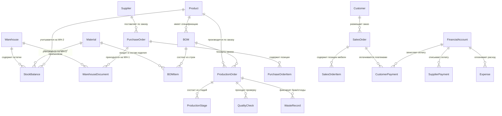

# FurniCore ERP — Руководство по базе данных (Database Guide)

## 1. Концепция базы данных
База данных **FurniCore ERP** развёрнута в реляционной СУБД **PostgreSQL 16** (`furnicore_db`).
Все таблицы, связи, типы полей и ограничения целостности управляются через систему миграций Django ORM.

Для финансовых сумм и складских остатков строго используется тип `DecimalField` (PostgreSQL `NUMERIC(14,2)` и `NUMERIC(10,3)`), что полностью исключает погрешности вычислений с плавающей точкой (IEEE 754 float), неприемлемые для ERP.

---

## 2. Схема связей данных (Entity-Relationship)

---

## 3. Описание ключевых моделей

### 3.1. Складской блок (`apps/warehouses/`)
- `Warehouse`
  - `code` (`WH-1`, `WH-2`) — уникальный строковый код склада.
  - `warehouse_type` (`RAW_MATERIALS`, `FINISHED_PRODUCTS`) — тип склада.
- `StockBalance`
  - `warehouse` (FK `Warehouse`) — склад размещения.
  - `material` (FK `Material`, nullable) — для склада WH-1.
  - `product` (FK `Product`, nullable) — для склада WH-2.
  - `current_stock` (`DecimalField`) — физический остаток на складе.
  - `reserved_stock` (`DecimalField`) — зарезервировано под подтверждённые заказы клиентов.
  - `available_stock` (property) — `current_stock - reserved_stock`.
- `WarehouseDocument` & `WarehouseDocumentItem`
  - `doc_number` — уникальный номер документа (например, `RCP-261101-A1`, `ISS-261102-B2`).
  - `doc_type` — 9 типов операций (`RECEIPT`, `PRODUCTION_ISSUE`, `PRODUCTION_RETURN`, `FINISHED_RECEIPT`, `RESERVATION`, `UNRESERVATION`, `SHIPMENT`, `CUSTOMER_RETURN`, `INVENTORY`).
  - `status` (`DRAFT`, `POSTED`, `CANCELLED`).
  - `posted_at`, `posted_by` — аудит проведения с защитой от повторного применения.

### 3.2. Производственный блок (`apps/production/` & `apps/quality/`)
- `BOM` (Bill of Materials) & `BOMItem`
  - Норма расхода материалов (плиты, брус, кромка, фурнитура) на единицу готовой продукции.
- `RoutingTemplate`
  - Шаблоны стадий для 5 основных групп мебели (шкафы, кухни, диваны, столы, кровати).
- `ProductionOrder`
  - `order_number` (`PO-2026-001`, etc.).
  - `product` (FK `Product`), `bom` (FK `BOM`).
  - `quantity_planned`, `status` (`DRAFT`, `WAITING`, `CHECKING_MATERIALS`, `MATERIALS_RESERVED`, `IN_PROGRESS`, `QUALITY_CONTROL`, `COMPLETED`, `CANCELLED`).
- `QualityCheck` (`apps/quality/`)
  - Семикритериальный чек-лист ОТК.
  - `decision` (`PASS`, `REWORK`, `FAIL`).

### 3.3. Блок продаж и закупок (`apps/sales/` & `apps/suppliers/`)
- `Customer` & `Supplier`
  - Контрагенты фабрики, контакты, реквизиты, город, адрес.
- `SalesOrder` & `SalesOrderItem`
  - Заказ клиента, статус (`NEW`, `CONFIRMED`, `IN_PRODUCTION`, `READY_FOR_SHIPMENT`, `SHIPPED`, `DELIVERED`, `CANCELLED`), скидка в процентах и сумме, итоговая стоимость `total_amount_kzt`.
- `PurchaseOrder` & `PurchaseOrderItem`
  - Заказ поставщику, статус (`DRAFT`, `SENT`, `PARTIALLY_RECEIVED`, `RECEIVED`, `CANCELLED`).

### 3.4. Финансовый блок (`apps/finance/`)
- `FinancialAccount`
  - Расчётные и кассовые счета фабрики: `account_type` (`CASH`, `BANK`, `PAYMENT_GATEWAY`), валюта KZT, `current_balance_kzt`.
- `CustomerPayment` & `SupplierPayment`
  - Движение денежных средств, привязка к конкретному счёту и заказу, флаг сторнирования.
- `Expense`
  - Расходы фабрики по статьям (`RENT`, `SALARY`, `UTILITIES`, `MAINTENANCE`, `TAX`, etc.).

---

## 4. Защита целостности данных и блокировки (Invariants)
1. **Защита от отрицательных остатков:** Все методы списания сырья или отгрузки готовой мебели выполняются в атомарной транзакции с блокировкой строки через `.select_for_update()`. При попытке списать больше физического остатка возбуждается исключение `ValidationError`.
2. **Идемпотентность документов:** Повторный вызов `post_document()` на документе со статусом `POSTED` блокируется и не меняет остатки повторно.
3. **Целостность платежей:** Сумма платежей покупателя по заказу проверяется перед зачислением; переплата сверх стоимости заказа блокируется валидатором.
