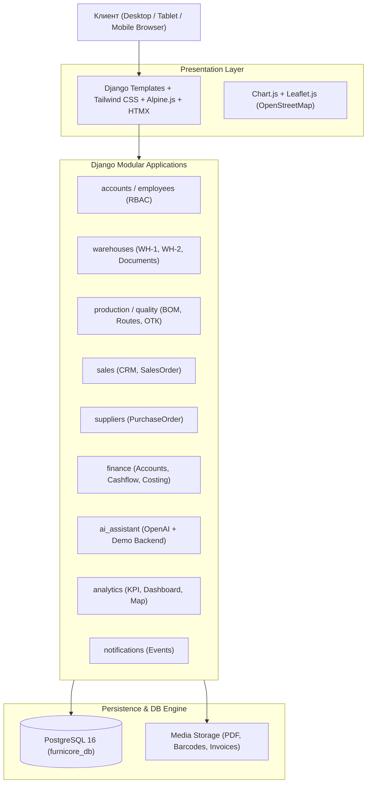

# FurniCore ERP — Системная архитектура (System Architecture)

## 1. Архитектурный стиль
**FurniCore ERP** построен по паттерну **модульного монолита** на стеке Django 5.x.
Выбор монолита обоснован принципами целостности транзакций (ACID), простотой развёртывания, централизованной схемой миграций и полным исключением распределённых сетевых сбоев, критичных для производственного учёта.

---

## 2. Технологический стек
- **Язык программирования:** Python 3.12.3
- **Веб-фреймворк:** Django 5.1.15
- **СУБД:** PostgreSQL 16 (порты по умолчанию: 5432 / 5435)
- **ORM:** Django ORM с агрегациями, `select_for_update()`, транзакциями `@transaction.atomic` и защитой от race conditions.
- **Интерфейс:** Django Templates + Tailwind CSS + Alpine.js + HTMX (реактивные динамические фрагменты без SPA-перегрузки).
- **Визуализация:** Chart.js (графики выручки, остатков, расходов), Leaflet 1.9.4 + OpenStreetMap (логистика).
- **Отчётность:** ReportLab (генерация PDF квитанций, спецификаций, ордеров), openpyxl (экспорт P&L и реестров в Excel `.xlsx`).
- **Тестирование:** pytest, pytest-django (64 комплексных интеграционных теста).

---

## 3. Декомпозиция приложений и зоны ответственности

| Приложение | Назначение | Ключевые модели |
|---|---|---|
| `accounts` | Аутентификация, профили, роли пользователей | `User`, `UserRole` |
| `employees` | Организационная структура, оклады, должности | `Employee`, `Department` |
| `warehouses` | Склады WH-1 и WH-2, документы движения, партии | `Warehouse`, `StockBalance`, `StockMovement`, `WarehouseDocument`, `WarehouseDocumentItem` |
| `materials` | Номенклатура сырья, единицы измерения, минимальные лимиты | `Material`, `MaterialCategory` |
| `products` | Каталог готовой мебели, категории, габариты, цены | `Product`, `ProductCategory` |
| `production` | Планирование выпуска, BOM, технологические маршруты, этапы | `ProductionOrder`, `BOM`, `BOMItem`, `RoutingTemplate`, `ProductionStage`, `WasteRecord` |
| `quality` | Контроль качества ОТК по 7 критериям | `QualityCheck` |
| `sales` | Клиенты, заказы покупателей, скидки, резервирование | `Customer`, `SalesOrder`, `SalesOrderItem` |
| `suppliers` | Реестр поставщиков, заказы на закупку, приёмка на WH-1 | `Supplier`, `PurchaseOrder`, `PurchaseOrderItem` |
| `finance` | Денежные счета, касса, банк, P&L, платежи, расходы, себестоимость | `FinancialAccount`, `CustomerPayment`, `SupplierPayment`, `Expense`, `AccountTransfer` |
| `ai_assistant`| Гибридный ассистент (OpenAI API + автономный локальный режим) | `ChatSession`, `ChatMessage` |
| `analytics` | Главный аналитический экран, KPI, карта партнеров | Представления на агрегатах ORM |
| `notifications` | Системный колокольчик, оповещения пользователей о событиях | `Notification` |

---

## 4. Концепция двух складов (Архитектурный инвариант)
В системе строго разграничены две физические зоны хранения:
1. **WH-1 — Склад сырья и материалов (RAW_MATERIALS):**
   - Хранит: ЛДСП, массив дерева, фурнитуру, крепеж, лаки, ткани, наполнители.
   - Поступление: приходные накладные (`RECEIPT`) от поставщиков по `PurchaseOrder`.
   - Расход: отпуск в цех (`PRODUCTION_ISSUE`) по технологической карте `BOM`.
2. **WH-2 — Склад готовой продукции (FINISHED_PRODUCTS):**
   - Хранит: шкафы, кухни, диваны, столы, кровати.
   - Поступление: приход готовых изделий из цеха (`FINISHED_RECEIPT`) исключительно после решения ОТК `PASS`.
   - Расход: резервирование под клиента (`RESERVATION`) и отгрузка (`SHIPMENT`).
> **Важно:** Производственный цех является технологическим процессом переработки, а не промежуточным складом.
